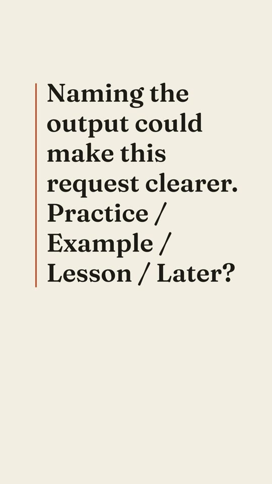

<p align="center"><picture><source media="(prefers-color-scheme: dark)" srcset="docs/assets/logo-on-dark.svg"></picture></p>

<p align="center"><b>Learn to prompt through your everyday work in Claude Code, Codex, ChatGPT and Claude. An open source coach that can review your past chats, with an optional 30-lesson course.</b><br>
<a href="https://entuvo.github.io/prompting-wizard/">Website</a> · <a href="#start">Start</a> · <a href="NATIVE-PLUGINS.md">ChatGPT &amp; Claude plugins</a> · <a href="https://github.com/Entuvo/prompting-wizard/issues">Issues</a></p>

<p align="center"><a href="https://youtube.com/shorts/s2WarFaRY2Q"></a></p>

## The same AI. Clearer direction.

> Review this report and tell me what matters.

The AI has to guess what "review" means, who the answer is for, and what shape it should take.

> Create a one-page briefing for a department head from this report. Identify the three decisions that need attention. For each decision, cite the supporting passage, explain the likely consequence of waiting, and end with one recommended next step.

Now it knows the audience, the deliverable, the evidence and the quality bar. Prompting Wizard teaches you which choices affect the result, using tasks you already do. A short prompt can be enough; a useful lesson does not always require a rewrite.

## Start

Prompting Wizard is one plugin. Download the file for your app from the [latest release](https://github.com/Entuvo/prompting-wizard/releases/latest):

| Your app | Download | How to install |
|---|---|---|
| Claude (web, desktop, Cowork) | `prompting-wizard-claude.zip` | **Customize → Plugins → upload** (paid plans). It also syncs to Claude Code when you sign in with the same account. |
| Claude Code | `prompting-wizard-claude.zip`, or none | Upload in Claude as above, or run `/plugin marketplace add Entuvo/prompting-wizard` and install **prompting-wizard**. |
| ChatGPT | `prompting-wizard-openai.zip` | A workspace admin publishes it to the workspace (**Plugins → Personal → Publish**). The public ChatGPT plugin directory listing is pending review. |
| Codex | `prompting-wizard-openai.zip`, or none | Run `codex plugin marketplace add Entuvo/prompting-wizard` and install **prompting-wizard**. |

Then start a new chat and say: “Use Prompting Wizard to teach me through my work; no interview.” For structured lessons, say “Start the Prompting Wizard course.” Details, device notes and the walkthrough are in [plugin setup](NATIVE-PLUGINS.md). Everyday coaching in the ChatGPT and Claude apps is a pilot: native behaviour on each device is still being verified.

Keep your current `LEARNING.md` and attach it in each new chat that needs your learning history; the plugin does not synchronize progress. If plugins are unavailable to your account, use the [one-time instructions and manual guide setup](NATIVE-APPS.md).

### Without the plugin: Claude Code or Codex

If you'd rather not install a plugin, load the course skill directly. Start in a folder you are comfortable letting your coding agent inspect: practice prompts run with the file and network access available to that session.

Paste this into Claude Code or Codex. It loads Prompting Wizard and offers everyday learning, the structured course, or later.

```text
Install or load Prompting Wizard from:

https://github.com/Entuvo/prompting-wizard/tree/main/prompting-wizard

This setup is for Claude Code or Codex. First determine which of those hosts you are running in and which capabilities it actually provides. Use its native skill, plugin, marketplace, repository, or filesystem installation method when available.

If persistent installation is unavailable but you can read GitHub, load Prompting Wizard for this chat by reading AGENTS.md and then SKILL.md from that repository path. Follow those instructions directly.

Do not overwrite an existing installation without asking me. Never claim the skill is installed unless the host confirms it. Do not stop after explaining installation or creating a package. Once Prompting Wizard is available, offer everyday learning without an interview, the structured course, or later. Honor my choice.

For everyday learning, accept my current LEARNING.md if supplied. After I accept a learning record, return the complete updated card for me to retain unless a durable file write succeeds. Never claim it is saved or synced without that write.

For the structured course, if this environment cannot preserve files between chats, accept an attached PROGRESS.md and return the complete updated PROGRESS.md after every state change.

If you can neither install the skill nor read its files from GitHub, state exactly which capability is missing. Do not fabricate a successful installation.
```

Prefer commands? See [all install options](https://entuvo.github.io/prompting-wizard/#install).

After loading, ask “Learn through my work; no interview.” The skill alone provides teaching when you ask; it does not automatically watch later work or add after-task invitations. For explicit commands, use your installation's invocation:

| Installation | Everyday learning | Learning Card progress |
| --- | --- | --- |
| Claude Code plugin | `/prompting-wizard:pw learn` | `/prompting-wizard:pw learning` |
| Codex plugin | `$prompting-wizard:pw learn` | `$prompting-wizard:pw learning` |
| Claude Code standalone skills | `/pw learn` | `/pw learning` |
| Codex standalone skills | `$pw learn` | `$pw learning` |

With the same invocation, `start` enters the optional course and `progress` shows course progress. Automatic after-result invitations in coding agents require the separate [local coaching setup and workspace opt-in](COACHING.md). Installing the skill or asking for a lesson does not enable collection. Paused, excluded, lesson-only and never-enabled workspaces receive explicitly requested teaching only.

## Everyday learning

**Finish work → choose a learning opportunity → practise → reflect → retain evidence.** You can stop after any step.

When you ask for teaching, or an invitation is enabled through the setup above, a useful opportunity after a completed task might be: “Naming the output could make this request clearer. Practice / Example / Lesson / Later?”

- **Practice:** write your own change and separately predict its effect. If you choose Retry, the coach runs the revised prompt without the prediction, then asks what changed before assessing it.
- **Example:** see a brief demonstration, with an optional return to practice.
- **Lesson:** learn the principle using your task, then practise if you want.
- **Later:** continue your work without a penalty or backlog.

Same-chat retries are exploratory because the earlier answer remains in context. No improvement is a valid result. External actions are never repeated simply to compare prompts.

Tips default to occasional; choose frequent or on-request using the [frequency instructions](NATIVE-APPS.md#start-with-lightweight-coaching). “More”, “less” or “pause coaching” applies to the current chat; change account instructions for later app chats. These preferences do not change coding-host collection settings or hook frequency.

## Learn from your past work

`pw history` reads your recent work once and shows where your prompts cost you turns. It looks for the follow-up that says "no, I meant…", an interrupted run, a prompt you edited, or a rule you had to repeat. It turns those into a baseline, a casebook of your own prompts with one-edit rewrites, and lesson suggestions. It asks before reading and again before scoring, because scoring sends the sampled prompts through your assistant and uses your quota.

| Source | How it is read |
|---|---|
| Claude Code sessions | Claude Agent SDK (`pip install claude-agent-sdk`) |
| Codex sessions | Codex SDK (`pip install openai-codex`) |
| ChatGPT or Claude app data export | the `.zip` or `conversations.json` you download from the app's settings; no SDK needed |

In Claude Code or Codex, results stay in a local folder you choose and are deleted after 30 days. Transcript files are never parsed. Nothing is written to your course, Learning Card or config files unless you accept it.

Each provider's history is reviewed only by that provider's hosts: Claude Code and Claude review Claude exports, and Codex and ChatGPT review ChatGPT exports. In the apps, upload only that app's own export: an upload reaches the provider even when the plugin declines it. Inside ChatGPT or Claude, the plugin can review that app's own export when you upload it, up to 30 recent conversations. It reports your top gaps and three of your own cases in the chat, and proposes card records for you to accept. It cannot store a casebook. See [design](design/history-analysis.md) and [privacy](PRIVACY.md#learning-from-past-work-history).

## Carry learning between chats

With the guide and current card available, the coach proposes a short record after meaningful learning. It distinguishes practice with help from independent use; reading an example does not prove that you learned the skill.

In chat apps, when you accept the record, ask for the complete updated `LEARNING.md`, save it yourself, and attach it in your next chat—even when switching between ChatGPT and Claude. Replace an old project upload deliberately. Without the current card, the coach cannot reliably know your learning history. It uses accepted evidence and the current task to suggest a relevant next opportunity.

Nothing synchronizes automatically. Instructions do not watch other chats or connect provider accounts. Automatic continuity is not implemented.

## How a course lesson works

For a more structured path, choose the optional course: an initial assessment followed by thirty guided lessons, each built on a task from your own working life. Everyday mini-lessons do not advance this course.

- **Write.** You write a prompt for one of your real tasks.
- **Run.** Your prompt runs exactly as you wrote it. It is not quietly improved first.
- **Compare.** When one targeted change would help, both versions run on the same material in separate contexts.
- **Improve.** You name the change that mattered and get a score against a clear standard.

Four stages: **Diagnose, Control, Build, Harden.** Work at your own pace; skipping a session costs nothing.

## Who it's for

Anyone who already asks AI for help and wants more control over the result. No coding knowledge is required for the teaching itself.

- A **teacher** turns source material into a lesson plan with a defined age level and objective.
- A **lawyer** extracts obligations, dates and exceptions, keeping conclusions tied to the text.
- A **manager** turns meeting notes into decisions, owners and deadlines.
- A **researcher** separates evidence from inference.

You bring the professional judgment. Prompting Wizard teaches you how to communicate it.

Course progress is kept in `PROGRESS.md`, or shared local state when the optional coding-host integration is active. Everyday learning uses the separate `LEARNING.md` card; there is no automatic bridge between them. Learning outcomes have not yet been established through human learner testing.

## More

- [Website](https://entuvo.github.io/prompting-wizard/): the full course outline, install options, `pw` commands and updates
- [Lessons](https://entuvo.github.io/prompting-wizard/lessons/): short videos from 18 of the 30 lessons, each with its before and after
- [ChatGPT and Claude plugins](NATIVE-PLUGINS.md): package setup, device walkthrough and portable Learning Cards
- [Optional automatic coaching in Claude Code/Codex: technical setup](COACHING.md) · [Privacy](PRIVACY.md) · [Terms](TERMS.md) · [Support](SUPPORT.md)
- **Contributing:** lessons live in `prompting-wizard/days/`, rubrics in `prompting-wizard/rubrics.md`. Run `python3 tools/validate.py --complete`, `python3 tools/check_site.py` and the `tools/test_*.py` suites before a pull request. Enable the repo hooks once per clone: `git config core.hooksPath tools/hooks`. End-to-end checks on real hosts: `python3 tools/e2e_hosts.py` (Claude Code, Codex, and Claude/ChatGPT simulations via API keys; see its docstring).

MIT License · Made by [Entuvo](https://www.entuvo.com), a venture studio that builds AI Native businesses.
